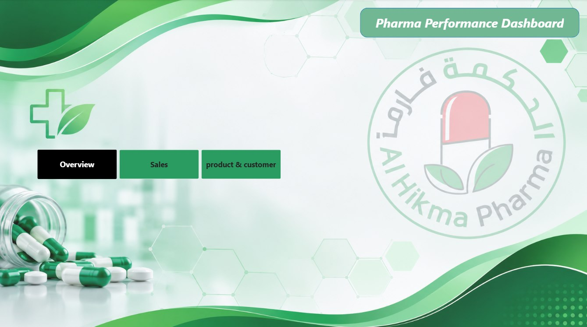
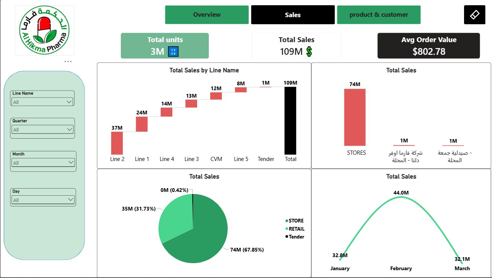
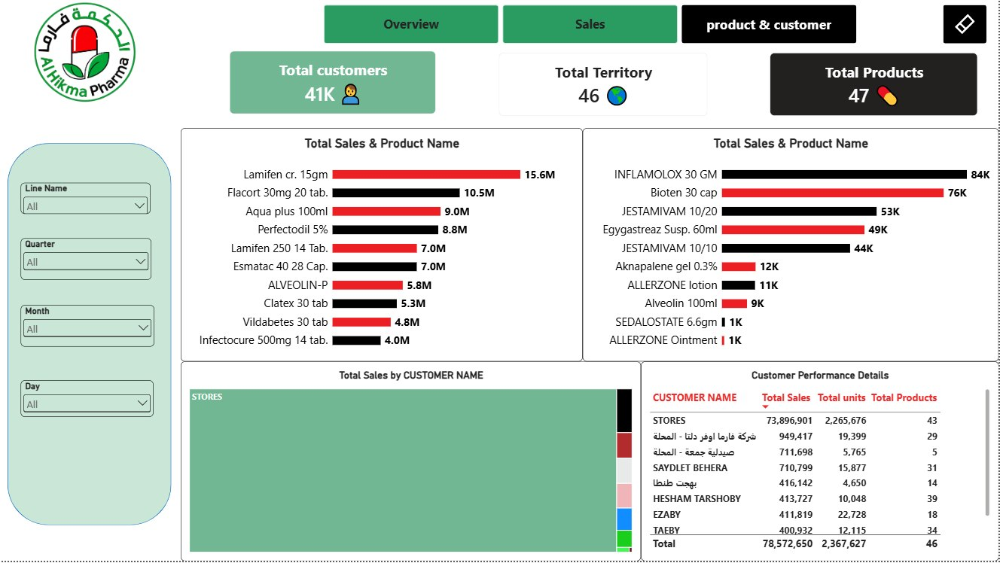

# Farmnacy | Pharma Performance Dashboard

An interactive **Power BI** dashboard that turns pharma sales data into a clear story a sales manager can read in seconds: what sells, to whom, through which channel, and when.



> **Note:** The data in this project is sample data created for learning and portfolio purposes. It is not real company data.

---

## Key Numbers

| Metric | Value |
|---|---|
| Total sales | 109M |
| Units sold | ~3M |
| Products | 47 |
| Territories | 46 |
| Period covered | January – March |

## Highlights

- **Peak month:** February reached 44M, about 34% above January (32.8M). March settled at 32.1M.
- **Channel mix:** the STORE channel drives 67.85% of sales (74M), RETAIL adds 31.73% (35M).
- **Product lines:** Line 2 leads with 37M, roughly one third of total sales.
- **Top products:** Lamifen cr. 15gm (15.6M), Flacort 30mg 20 tab. (10.5M) and Aqua plus 100ml (9.0M).

## Dashboard Pages

### 1. Overview
A clean entry point with navigation to every section.

### 2. Sales
Total sales and units, sales by product line (waterfall), by customer, by sales type (STORE / RETAIL / Tender) and by month.



### 3. Product & Customer
Total customers, territories and products, top products by sales, sales by customer and a customer performance table.



## Business Questions Answered

1. Which product lines and products generate the most revenue?
2. How do sales change from month to month?
3. Which sales channel contributes the most?
4. Which customers and territories matter most?

## Features

- Interactive slicers for **Line Name, Quarter, Month and Day**
- One-click **Clear all slicers** button
- Custom page navigation
- Consistent green pharma theme with custom backgrounds
- Reusable DAX measures

## DAX Measures

| Measure | Definition |
|---|---|
| Total Sales | `SUM(Table3[SALES VALUE])` |
| Total units | `SUM(Table3[SALES UNITS])` |
| Total customers | `DISTINCTCOUNT(Table3[CUSTOMER NAME])` |
| Total Products | `DISTINCTCOUNT(Table3[EGPI Product Name])` |
| Total Territory | `DISTINCTCOUNT(Table3[Territory])` |

## Repository Structure

```
farmnacy-powerbi-dashboard/
├── Dashboard/
│   └── farmnacy.pbix
├── Documentation/
│   └── Project-Description.md
├── Screenshot/
│   ├── overview.png
│   ├── sales.png
│   └── product-customer.png
├── .gitignore
├── LICENSE
└── README.md
```

Full details are in [Documentation/Project-Description.md](Documentation/Project-Description.md).

## How to Open

1. Install [Power BI Desktop](https://powerbi.microsoft.com/desktop/) (free, Windows).
2. Download `Dashboard/farmnacy.pbix`.
3. Open it in Power BI Desktop and explore the three pages.

## Future Improvements

- Build a star schema (Fact_Sales, Dim_Date, Dim_Customer, Dim_Product)
- Add a dedicated Date table and month-over-month growth measures
- Add Top N customers with a drill-through page
- Add tooltip pages for products and customers

## Author

**[Your Name]**
[LinkedIn](https://www.linkedin.com/in/your-profile) · [GitHub](https://github.com/your-username)

Feedback and suggestions are welcome.

## License

This project is licensed under the MIT License.
